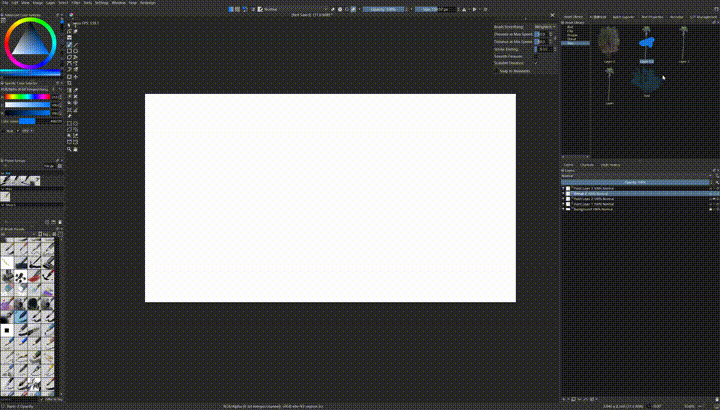

# TFM — Tool & Filter & Menu

Krita plugin for custom menus, native filters, Advance Selection, an asset library, and related tools.

Requires **Krita 5.3** on Windows (Qt5 build). Restart Krita after installing or updating.

## Features

- **Custom menus** — build popup lists (Quick Tool and more), nest items, assign shortcuts, import/export configs. Open at the cursor with a hotkey.
- **Native filters** (`kritatfm.dll`) — Bloom, Film Grain, Lens Distortion, Vignette, Color Temperature, Vibrance, Kuwahara, Halation, Lens Flare, Anamorphic Flare, Light Rays, Light Leaks, Light Patch, Statistical / Guided Color Match, Background Removal (BiRefNet), Color Range Mask, Circular / Zoom Motion Blur, Focus Blur.
- **Vulkan backends** — GPU filter compute runs in `tfm_vulkan_worker.exe` (out of process). Global default in Settings, per-filter override under Filters → Compute backend (Auto / CPU / GPU).
- **Advance Selection** — luminance / channel / sampled-color range selection with live preview (Select menu or Quick Tool).
- **Asset Library** — categorized cutouts you can place onto the canvas; save the active layer as an asset.
- **Quick Image Search** — search panel for reference images (optional tool).
- **Layer Color Space** — convert all layers to the document default color space (optional tool).

## Gallery

   
  <em>Configure TFM — Menus (custom lists), Filters (catalog + per-filter backend), Tools (Advance Selection and panels)</em>  
   
  <em>Quick Tool popup (shortcut Q) — Advance Selection, TFM filters, and nested Quick Filter items at the cursor</em>  
   
  <em>Demo — use custom Quick Tool / popup actions while painting</em> 
  <a href="https://github.com/VictoryLuode/Krita-TFM/releases/download/0.1.6/tfm-demo-1.mp4">Demo 1 (mp4)</a>  
   
  <em>Demo — Asset Library: browse categories and place cutouts on the canvas</em> 
  <a href="https://github.com/VictoryLuode/Krita-TFM/releases/download/0.1.6/tfm-demo-2.mp4">Demo 2 (mp4)</a>

Open **Tools → TFM → Configure TFM** for menus, filters, tools, and backends. **Select → Advance Selection…** (also on the Quick Tool popup) for luminance / color-range selections.

## Install (prebuilt)

Close Krita first. From a release zip (`python package_release.py` builds `dist/TFM-<version>.zip`):

1. Copy everything under `resource/` into your Krita **resource** directory.
2. Copy `kritaplugins/kritatfm.dll` and `kritaplugins/tfm_vulkan_worker.exe` into the Krita install `lib/kritaplugins/` folder. Keep both files in the same directory.
3. Start Krita and enable **TFM** under Settings → Manage Resources → Python Plugin Manager if needed.

Settings and menu lists live under `<ResourceDirectory>/TFM/`. BiRefNet models for Background Removal are optional and go under `TFM/background-removal/models/`.

## Release helpers

- `python verify.py` — `__version__` must match the newest `X.Y.Z` git tag.
- `python package_release.py` — zip resource files plus the current `build/native-5.3/bin` DLL and worker.

## Filter backends

- **Settings → Default filter backend**: Auto / CPU / GPU (Vulkan) for filters that support it.
- **Filters** tab → select a Vulkan-capable filter → **Compute backend** for a per-filter override.
- Background Removal keeps its own backend control in the filter dialog.

## Build from source

See `SOURCE-NOTES.md`. Filter plugin: `python native/fx/build.py`. License: GPL-3.0 (`LICENSE`); Menubelt-derived menu code: `LICENSE-MENUBELT`.
