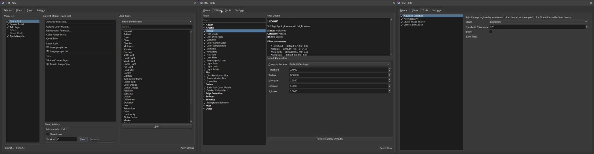
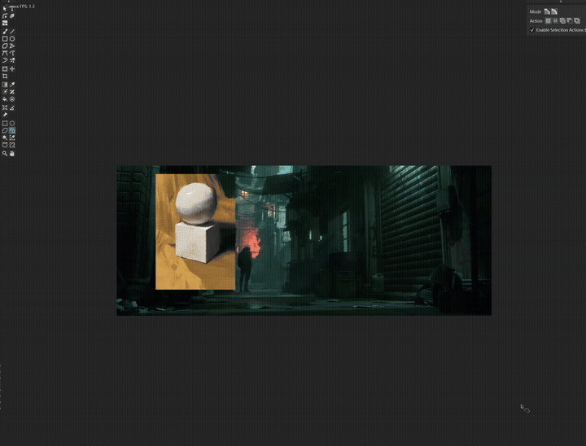
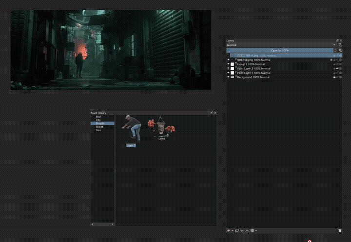

# TFM — Tool & Filter & Menu

Custom **menus**, **native filters**, **Advanced Selection**, and an **asset library** for Krita — one plugin under **Tools → TFM**.

## Highlights

- **Custom menus** — multi-list popups (list or pie), nested items, per-list shortcuts, import / export.
- **Native filters** — Bloom, Film Grain, flares, light leaks, Guided / Statistical Color Match, Background Removal, motion / focus blur, and more via `kritatfm.dll`.
- **Vulkan compute** — GPU work runs in `tfm_vulkan_worker.exe` (out of process). Global default in Settings; per-filter **Compute backend** override.
- **Advanced Selection** — luminance / channel / sampled-color ranges with live preview.
- **Asset Library** — categorized cutouts onto the canvas; save the active layer as an asset.
- **Quick Image Search** · **Layer Color Space** — optional tools you can enable under Configure TFM → Tools.

## What's new in 0.1.9

- Complete TFM branding cleanup for native sources and build/test env names (legacy aliases kept).
- Configure Filters/Settings i18n, clearer filter enable restart cues, and BiRefNet model-folder onboarding.
- Menu theme/row module split; Relight stays experimental; docs match 30s GPU idle TTL and Auto warm Vibrance.

Full changelog: [RELEASE_NOTES.md](RELEASE_NOTES.md).

## Demo

*Quick Tool / popup actions while painting* — [Demo 1 (mp4)](https://github.com/VictoryLuode/Krita-TFM/releases/download/0.1.6/tfm-demo-1.mp4)

*Asset Library — browse categories and place cutouts* — [Demo 2 (mp4)](https://github.com/VictoryLuode/Krita-TFM/releases/download/0.1.6/tfm-demo-2.mp4)

*Quick Tool popup (shortcut **Q**) — nested filters and TFM actions at the cursor*

## Install

> **Requires Krita 5.3 on Windows (Qt5 build).** Close Krita before installing or updating.

**OS support:**

- [x] Windows (10, 11) — Krita 5.3 Qt5
- [ ] Linux
- [ ] macOS
- [ ] Android

1. Download `TFM-0.1.9.zip` (or the newest `TFM-*.zip`) from [Releases](../../releases).
2. Copy everything under `resource/` into your Krita **resource** directory.
3. Copy `kritaplugins/kritatfm.dll` and `kritaplugins/tfm_vulkan_worker.exe` into the Krita install `lib/kritaplugins/` folder (same directory).
4. Start Krita and enable **TFM** under **Settings → Manage Resources → Python Plugin Manager** if needed.

Settings and menu lists live under `<ResourceDirectory>/TFM/`. Optional BiRefNet models for Background Removal go under `TFM/background-removal/models/` (`BiRefNet-lite-F16.gguf`, `BiRefNet-dynamic-F16.gguf`). They are not in the zip — use **Configure TFM → Filters → Open BiRefNet models folder** (writes a local `README.txt`) after installing compatible GGUF weights.

## Quick start

**Tools → TFM → Configure TFM**

- **Menus** — build Quick Tool (and other lists), add Krita actions / filters / scripts, bind shortcuts.
- **Filters** — enable TFM filters and set defaults / **Compute backend**, then **restart Krita** so they appear in the Filter menu.
- **Tools** — turn on Advanced Selection, Asset Library, Quick Image Search, Layer Color Space (checkboxes apply immediately).
- **Settings** — window size, CPU threads, default filter backend.

Open the cursor popup with your list shortcut (often **Q** for Quick Tool), or use **Select → Advanced Selection…**.

## Community

- [Report a bug](../../issues)
- [Latest release](../../releases)

## Build from source

See [SOURCE-NOTES.md](SOURCE-NOTES.md). Filter plugin: `python native/fx/build.py`.

## License

[GPL-3.0](LICENSE).
